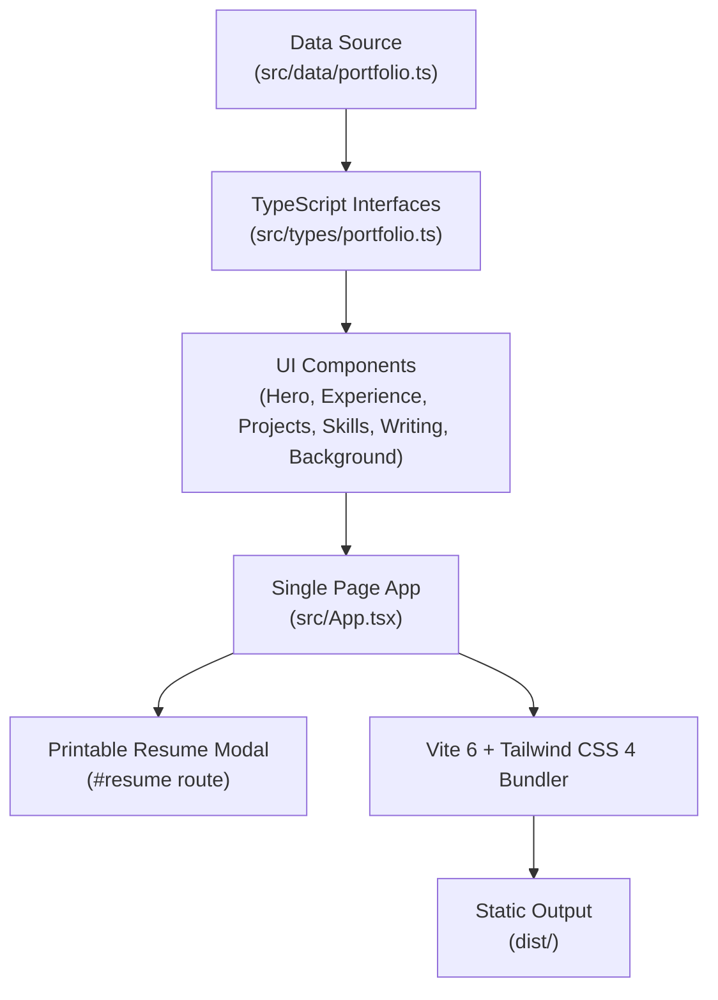

<div align="center">

# 💼 Md Abul Kalam — Portfolio & Engineering Showcase

### Personal portfolio and technical showcase of Md Abul Kalam, Software Technical Lead specializing in healthcare SaaS, distributed cloud systems, and payment platforms with .NET, Azure, and React.

[](https://react.dev/)
[](https://www.typescriptlang.org/)
[](https://vite.dev/)
[](https://tailwindcss.com/)
[](LICENSE)

[Overview](#-overview) •
[Key Highlights](#-key-highlights) •
[Site Sections](#-site-sections) •
[Architecture](#-architecture) •
[Repository Layout](#-repository-layout) •
[Content Customization](#-content-customization) •
[Getting Started](#-getting-started) •
[Author](#-author) •
[License](#-license)

</div>

---

## 📌 Overview

This repository powers the personal portfolio website of **Md Abul Kalam**, a hands-on Software Technical Lead at **Enosis Solutions** building mission-critical healthcare practice management software and multi-tenant payment platforms with ASP.NET Core, Microsoft Azure, PostgreSQL, and React.

The site is built as a blazing-fast, single-page application with **React 19**, **TypeScript**, **Vite 6**, and **Tailwind CSS 4**. It operates with a **zero-backend architecture** where all biographical, professional, architectural, and educational content lives in a single, strongly-typed configuration file ([`src/data/portfolio.ts`](src/data/portfolio.ts)).

---

## ✨ Key Highlights

- ⚡ **Pure Client-Side Static Architecture**: No external database or headless CMS runtime overhead. All sections and metadata are statically compiled and hydrated with zero external latency.
- 📊 **Interactive Career & Metric Infographics**:
  - **Career Path Progression Chart**: Proportional timeline diagram where bar widths correspond to time spent in each engineering role, rendered with an OKLab seniority color gradient, duration badges, and team size scopes.
  - **Competitive Programming Bar Chart**: Visual solve-count breakdown across 1,700+ solved algorithmic problems on major judges (Codeforces, LeetCode, URI/BeeCrowd, UVa, LightOJ, HackerRank), complete with judge links and an accessible screen-reader table fallback.
  - **Education & Milestone Timelines**: Chronological milestones for graduate (BUET) and undergraduate (RUET) degrees, competitive programming contest standings, and professional training.
- 📄 **Direct-Linkable Resume Modal (`#resume`)**:
  - Opens a clean, ATS-formatted one-page printable resume directly accessible via URL hash (`#resume`).
  - Includes dedicated `@media print` stylesheets and a one-click browser print / Save-as-PDF action.
- 🌓 **Zero-Flicker Theme Engine**:
  - Instant toggle between light and dark modes with persistent local storage.
  - Embedded pre-paint inline script prevents theme flashes on initial page load.
- ♿ **Accessibility & Ergonomics First**:
  - Semantic HTML5 structure, accessible keyboard focus indicators, "Skip to content" anchor for keyboard users, and full compliance with `prefers-reduced-motion`.
- 🎛 **Privacy & NDA Controls**:
  - Configuration flags to switch between anonymized and public client/product representations without refactoring UI code.
- 🎨 **Decoupled Icon Registry**:
  - Centralized SVG and Lucide icon registry ([`src/components/Icons.tsx`](src/components/Icons.tsx)) allowing the data layer to reference icons by name without importing React components into content files.

---

## 🧭 Site Sections

| Section | Description |
| :--- | :--- |
| **Hero / Intro** | Introduction, current engineering focus ("Right now" activity badges with icons), quick metrics, and quick links to resume, email, LinkedIn, and GitHub. |
| **Experience** | Career progression at Enosis Solutions from Software Engineer to Technical Lead, interactive Career Path chart, architectural highlights, and tech stacks. |
| **Projects** | Filterable open-source architectures, full-stack microservices, and engineering templates with architecture tags and GitHub links. |
| **Skills** | Comprehensive technical matrix grouped into Backend, Frontend, Cloud & Azure, Identity & Payments, Data, Delivery, and Engineering Leadership. |
| **Writing** | Peer-reviewed IEEE research publication on distributed data collection, technical deep-dives, and blog articles. |
| **Background** | Formal education (BUET, RUET), competitive programming solve statistics, awards/honors, and professional training certifications. |
| **Contact** | Direct communication details, timezone availability (UTC+6), and social channels. |

---

## 🏛 Architecture



> [!NOTE]
> All content changes made in `src/data/portfolio.ts` propagate automatically across both the web presentation and the printable resume view.

---

## 📂 Repository Layout

```text
portfolio-blog/
├── public/
│   ├── favicons/               # Multi-platform browser and touch favicons
│   └── md-abul-kalam.png       # Profile portrait asset
├── src/
│   ├── components/
│   │   ├── Background.tsx      # Education, competitive programming chart, honors
│   │   ├── CareerPath.tsx      # Proportional seniority and role timeline chart
│   │   ├── Contact.tsx         # Contact section and social links
│   │   ├── Experience.tsx      # Work experience timeline and accomplishments
│   │   ├── Footer.tsx          # Page footer and copyright
│   │   ├── Header.tsx          # Navigation header, reading progress bar, theme switch
│   │   ├── Hero.tsx            # Hero introduction and "Right now" badges
│   │   ├── Icons.tsx           # Lucide icon registry and branded SVGs
│   │   ├── Projects.tsx        # Filterable project showcase
│   │   ├── ResumeView.tsx      # Print-optimized one-page resume modal
│   │   ├── Section.tsx         # Reusable accessible section container
│   │   ├── Skills.tsx          # Grouped technical skill pills
│   │   ├── Tags.tsx            # Reusable badge and chip components
│   │   └── Writing.tsx         # IEEE publication and technical writing
│   ├── data/
│   │   └── portfolio.ts        # Central single source of truth for portfolio content
│   ├── hooks/
│   │   ├── useActiveSection.ts # Intersection-observer-based section spy
│   │   └── useTheme.ts         # Dark/light theme state and local storage hook
│   ├── types/
│   │   └── portfolio.ts        # TypeScript schemas and data interfaces
│   ├── App.tsx                 # Main application layout and hash route listener
│   ├── index.css               # Tailwind CSS 4 theme tokens and print styles
│   └── main.tsx                # React DOM root entry point
├── index.html                  # HTML entry point with inline pre-paint theme script
├── package.json                # Project dependencies and script declarations
├── tsconfig.json               # TypeScript compiler configuration (strict mode)
└── vite.config.ts              # Vite bundler configuration with Tailwind plugin
```

---

## 🛠 Content Customization

All personal and technical content is isolated in [`src/data/portfolio.ts`](src/data/portfolio.ts).

### Privacy & NDA Toggles
Two configuration variables at the top of the file manage visibility:
- `NAME_CLIENT`: Set to `true` to name the client and associated commercial products; keep `false` to display anonymized descriptions compliant with NDAs.
- `profile.openToWork`: Set to `true` to display a recruiter-facing "Open to roles" banner in the hero and contact sections.

### Updating Media & Assets
- **Profile Photo**: Place your portrait at `public/md-abul-kalam.png` (or update `profile.photo` path in `portfolio.ts`).
- **Favicons**: Custom favicon assets are located under `public/favicons/`.

### Registering New Icons
If you need additional icons from `lucide-react`, register them in [`src/components/Icons.tsx`](src/components/Icons.tsx):
```typescript
export const iconRegistry = {
  // Add new mappings here:
  docker: Container,
} satisfies Record<string, LucideIcon>;
```
You can then refer to `'docker'` directly inside `portfolio.ts` without introducing UI imports into your data.

---

## 🚀 Getting Started

### Prerequisites
- **Node.js**: `20.x` or later
- **npm** (or compatible package manager)

### Installation
1. Clone the repository:
   ```bash
   git clone https://github.com/akazad13/portfolio.git
   cd portfolio
   ```

2. Install dependencies:
   ```bash
   npm install
   ```

3. Start the local development server:
   ```bash
   npm run dev
   ```
   Open [http://localhost:3000](http://localhost:3000) in your browser.

### Available Scripts

| Script | Purpose |
| :--- | :--- |
| `npm run dev` | Runs the local Vite development server on port 3000. |
| `npm run build` | Runs TypeScript type checking (`tsc --noEmit`) and compiles the static site to `dist/`. |
| `npm run preview` | Serves the generated production build locally for verification. |
| `npm run lint` | Runs the TypeScript compiler in no-emit mode to check for type errors. |

---

## 👤 Author

**Md Abul Kalam**  
*Software Technical Lead • .NET & Azure Specialist*

- 🌐 **Blog**: [akazad.dev/blog](https://akazad.dev/blog)
- 💼 **LinkedIn**: [linkedin.com/in/akazadcse13](https://www.linkedin.com/in/akazadcse13/)
- 🐙 **GitHub**: [@akazad13](https://github.com/akazad13)
- ✉️ **Email**: [akazad.cse13@gmail.com](mailto:akazad.cse13@gmail.com)

---

## 📄 License

This project is licensed under the [MIT License](LICENSE).
